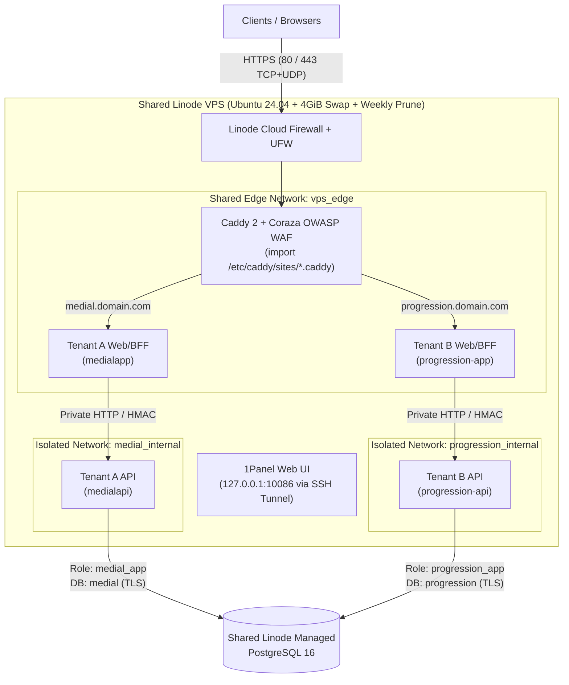

# appitect-mini

Infrastructure as code for low-tier usage — a Terraform-provisioned, production-hardened **shared infrastructure platform** for hosting multiple low-demand applications on a single Linode VPS.

---

## Purpose

**`appitect-mini`** solves the cost vs. isolation tradeoff for small, internal, or low-traffic applications. Provisioning a dedicated VPS, firewall, reverse proxy, and WAF for every low-demand app creates unnecessary cloud spend and maintenance overhead; conversely, manually stacking multiple apps onto one server leads to port collisions, noisy-neighbor memory crashes, stale Docker disk bloat, and cross-application security exposure.

`appitect-mini` provisions a single Linode VPS (and an optional shared Linode Managed PostgreSQL cluster) with **repeatable, version-controlled infrastructure**. Every hosted application gets automatic HTTPS, **OWASP Core Rule Set (CRS) Web Application Firewall** inspection at the edge, **1Panel** web-based server management, and its own **isolated private Docker network** (`<app_slug>_internal`) so one tenant's backend API can never be reached by another tenant's containers.

> Need **dedicated hardware per application** for higher-throughput or strict single-tenant compliance workloads? Use **`appitect`** instead.

---

## Technology Stack & Why Each Component Is Included

`appitect-mini` is split into two layers: the **Control Plane** (which provisions and tracks cloud resources) and the **Data Plane** (which runs on the shared VPS to secure, route, and monitor hosted applications).

### 1. Control Plane (Provisioning, State & Automation)

| Technology | Version / Provider | Purpose & Why It Was Included |
| :--- | :--- | :--- |
| **Terraform** | `>= 1.6.0` (`~1.9.0` in CI) | Declaratively provisions and updates the Linode VPS, Cloud Firewall, and optional Managed PostgreSQL cluster. Guarantees reproducible builds and zero manual click-ops drift. |
| **Linode Terraform Provider** | `linode/linode ~> 3.0` | Official Akamai/Linode provider (Plugin Protocol v6) managing `linode_instance`, `linode_firewall`, and `linode_database_postgresql_v2` via Linode APIv4. |
| **Random Provider** | `hashicorp/random ~> 3.6` | Automatically generates cryptographically strong VPS root passwords, 1Panel admin passwords, and randomized 1Panel secret URL entrance slugs so no default credentials ever exist. |
| **Linode Object Storage (S3 Backend)** | Terraform `backend "s3"` | Stores `terraform.tfstate` privately outside Git. **Required for CI/CD** because GitHub Actions runners are ephemeral — without remote state, subsequent `terraform apply` runs would attempt to create duplicate servers instead of updating the existing VPS. |
| **GitHub Actions** | [`.github/workflows/terraform.yml`](.github/workflows/terraform.yml) | Enforces `terraform fmt` and `terraform validate` on every push/PR, runs a dry-run `terraform plan` on Pull Requests to `main`, and executes `terraform apply` automatically on merge to `main`. |

### 2. Data Plane (Shared VPS Runtime, Security & Management)

| Technology | Role | Purpose & Why It Was Included |
| :--- | :--- | :--- |
| **Ubuntu 24.04 LTS + `cloud-init`** | Base OS & First-Boot Bootstrap | Native support for Linode's Metadata `user_data` service. Automates first-boot hardening (`deploy` user, SSH password auth disabled, `ufw`, `fail2ban`, `unattended-upgrades`) and installs the entire host stack with zero manual SSH setup. |
| **Linode Cloud Firewall** | Perimeter Network Firewall | Drops all inbound traffic at the Akamai datacenter edge **before** packets reach the VPS OS, allowing only SSH (`22/tcp`), HTTP (`80/tcp`), and HTTPS/HTTP3 (`443/tcp`, `443/udp`). Keeps 1Panel (`10086`) and container ports completely unreachable from the public internet. |
| **Swapfile + `sysctl` Tuning** | Multi-Tenant OOM Protection | Provisions a 4 GiB `/swapfile` (configurable via `swap_size_gb`) with `vm.swappiness=10` and `vm.vfs_cache_pressure=50`. Absorbs brief memory spikes across multiple Node/Bun/Next.js containers without triggering Linux OOM kills. |
| **Docker Engine + Compose v2** | Container Runtime & Isolation | Isolates each application's runtime and dependencies. Configured via `/etc/docker/daemon.json` with strict JSON log rotation (`10m` x `3` files), `live-restore: true`, raised file descriptor limits (`65536`), and a weekly `cron` job (`/etc/cron.weekly/appitect-docker-prune`) to prevent shared disk exhaustion from frequent CI deployments. |
| **Caddy 2 (Custom `xcaddy` Build)** | Multi-Tenant Edge Reverse Proxy | Automatically obtains and renews Let's Encrypt TLS certificates (with HTTP/3 QUIC and zstd/gzip compression) for every hosted tenant domain. Uses `import /etc/caddy/sites/*.caddy` so new apps can be added or removed with **zero downtime** via `caddy reload`. |
| **Coraza WAF + OWASP CRS** | Web Application Firewall | Compiled directly into Caddy (`github.com/corazawaf/coraza-caddy/v2`). Inspects every incoming HTTP/HTTPS request against the **OWASP Core Rule Set** (blocking SQLi, XSS, LFI, scanner probes, and protocol attacks) at the edge before traffic reaches any application container. Supports per-tenant `On` (blocking) or `DetectionOnly` (audit) modes. |
| **1Panel** | Web Control Panel | Lightweight, Docker-native cPanel alternative installed silently (`PANEL_NON_INTERACTIVE=true`) on host port `10086`. Provides a web UI for live CPU/RAM/disk metrics, File Manager, Web Terminal, container logs, and host firewall visibility without installing conflicting web servers on ports `80`/`443`. |
| **Linode Managed PostgreSQL 16** *(Optional)* | Shared Managed Database | Offloads database maintenance, TLS encryption, and automated daily snapshots to Linode. IP-allowlisted strictly to the VPS's public IPv4/IPv6. Paired with [`scripts/create-tenant-db.sh`](scripts/create-tenant-db.sh) to give each low-usage app its own isolated database and least-privilege role on a single cost-effective cluster. |

---

## Multi-Tenant Shared Architecture



### How Tenant Isolation & Stability Are Enforced
1. **Dual-Network Isolation**: Only a tenant's public-facing web/BFF container joins `vps_edge`. Private backend APIs attach **only** to their own `<app_slug>_internal` Docker bridge network — making Tenant A's API unreachable from the internet, from Caddy, and from Tenant B's containers.
2. **Lifecycle Protection**: `linode_instance.vps` sets `lifecycle { ignore_changes = [metadata, root_pass] }` in [`terraform/main.tf`](terraform/main.tf) so adding or modifying tenants later never destroys and recreates a live shared VPS.
3. **Noisy-Neighbor Caps**: Application repositories deploying onto `appitect-mini` should set explicit `mem_limit` and `cpus` limits (see [`templates/docker-compose.tenant.example.yml`](templates/docker-compose.tenant.example.yml)).
4. **Decoupled Application Repos**: Application repos (`medialapi`, `medialapp`, etc.) contain **no Caddy or host config** — they simply deploy into `/opt/apps/<app_slug>/` and join the pre-created `vps_edge` and `<app_slug>_internal` networks.

---

## Repository Structure

```text
appitect-mini/
├── .github/workflows/
│   └── terraform.yml                        # CI: fmt & validate, PR plan, and main branch apply
├── edge/
│   ├── Dockerfile.caddy                     # Multi-stage xcaddy build with coraza-caddy/v2 OWASP WAF
│   ├── Caddyfile.tftpl                      # Global Caddyfile with (coraza_waf_on)/(coraza_waf_detect) snippets
│   ├── site.caddy.tftpl                     # Per-tenant Caddy site template (domain, WAF mode, body cap, JSON logs)
│   └── docker-compose.yml                   # Runs appitect-mini-caddy on external `vps_edge` network
├── scripts/
│   ├── onboard-tenant.sh                    # Installed on VPS as `/usr/local/bin/appitect-onboard`
│   ├── offboard-tenant.sh                   # Installed on VPS as `/usr/local/bin/appitect-offboard`
│   ├── tenant-status.sh                     # Installed on VPS as `/usr/local/bin/appitect-status`
│   ├── create-tenant-db.sh                  # Creates isolated DB + least-privilege role on shared Postgres
│   └── sync-tenants.sh                      # Day-2 declarative sync of Terraform `hosted_apps` to a live VPS
├── templates/
│   └── docker-compose.tenant.example.yml    # Reference compose file with CPU/RAM quotas for hosted app repos
└── terraform/
    ├── versions.tf                          # Terraform >= 1.6, S3-compatible remote backend, Linode ~> 3.0
    ├── providers.tf                         # Linode APIv4 provider configuration
    ├── variables.tf                         # Validated inputs (`hosted_apps`, `swap_size_gb`, 1Panel, Postgres)
    ├── main.tf                              # VPS, Cloud-Init rendering, Linode Cloud Firewall, optional Managed DB
    ├── outputs.tf                           # Public IPs, tenant topology map, 1Panel & DB credentials
    ├── backend.hcl.example                  # Local S3-compatible remote state template (Linode Object Storage)
    ├── terraform.tfvars.example             # Multi-app starter configuration template
    └── templates/
        └── cloud-init.yaml.tftpl            # First-boot OS hardening, swap, Docker, 1Panel, CLI tools & Caddy+WAF
```

---

## Configuration Reference (GitHub Actions & Terraform)

### Required GitHub Actions Secrets (`Settings → Secrets and variables → Actions → Secrets`)

| Secret | Description |
| :--- | :--- |
| `LINODE_TOKEN` | Linode APIv4 Personal Access Token (Read/Write for **Linodes**, **Firewalls**, and **Databases** if enabled). |
| `SSH_PUBLIC_KEY` | Single-line OpenSSH **public key** (`ssh-ed25519 AAAA...`) injected into `root` and the `deploy` user. *(Note: Terraform never generates or stores private SSH keys; keep your matching private key locally and in your app repos' `LINODE_SSH_KEY` secret).* |
| `TF_STATE_BUCKET` | Private Linode Object Storage bucket name (e.g., `rlg-terraform-state`). |
| `TF_STATE_ENDPOINT` | Regional Linode Object Storage cluster URL **without** bucket prefix (e.g., `https://us-sea-1.linodeobjects.com`). |
| `TF_STATE_ACCESS_KEY` | Linode Object Storage S3 Access Key scoped to the bucket's region. |
| `TF_STATE_SECRET_KEY` | Linode Object Storage S3 Secret Key paired with `TF_STATE_ACCESS_KEY`. |

### GitHub Actions Variables (`Settings → Secrets and variables → Actions → Variables`)

| Variable | Default | Description |
| :--- | :--- | :--- |
| `CLUSTER_NAME` | `shared-01` | Identifier for the VPS (`appitect-mini-<cluster_name>`), Cloud Firewall, and default state path. |
| `RLG_SUPPORT_EMAIL` | `support@example.com` | Email registered with Let's Encrypt ACME in Caddy for TLS certificate notifications. |
| `HOSTED_APPS_JSON` | `{}` | JSON map of hosted tenant apps keyed by `app_slug` (see example below). |
| `TF_STATE_KEY` *(Optional)* | `appitect-mini/<cluster_name>/terraform.tfstate` | Custom path for the state file inside `TF_STATE_BUCKET`. |

Example `HOSTED_APPS_JSON`:
```json
{
  "medial": {
    "domain": "medial.yourdomain.com",
    "upstream_container": "medialapp",
    "upstream_port": 3000,
    "waf_mode": "On",
    "max_body_mb": 10
  },
  "progression": {
    "domain": "progression.yourdomain.com",
    "upstream_container": "progression-app",
    "upstream_port": 3000,
    "waf_mode": "On",
    "max_body_mb": 10
  }
}
```

---

## Step-by-Step Deployment Guide

### Option A: Automated Deployment via GitHub Actions (Recommended)

1. **Create a Linode Object Storage Bucket & Access Key** in Linode Cloud Manager (`Object Storage → Buckets` and `Access Keys`) for Terraform remote state.
2. **Add the Secrets and Variables** listed in the Configuration Reference above to your GitHub repository.
3. **Open a Pull Request targeting `main`**:
   - GitHub Actions automatically runs **`Format & Validate`** and **`Terraform Plan (PR)`**, showing the exact resources to be created without provisioning anything yet.
4. **Merge the Pull Request into `main`**:
   - GitHub Actions runs **`Terraform Apply (Main)`** to provision the Ubuntu 24.04 VPS, attach the Linode Cloud Firewall, and run `cloud-init`.
5. **Wait ~2–3 minutes for first-boot bootstrap**, then verify via SSH:
   ```bash
   ssh deploy@<VPS_IP> "sudo cloud-init status --wait && sudo appitect-status"
   ```
6. **Point DNS Records**: Create `A` (and `AAAA`) records for every domain in `HOSTED_APPS_JSON` pointing to the VPS's public IPv4 (and IPv6). Caddy will automatically issue TLS certificates for each domain.

### Option B: Local CLI Deployment

```bash
cd terraform
cp backend.hcl.example backend.hcl
cp terraform.tfvars.example terraform.tfvars
# Edit backend.hcl and terraform.tfvars with your values

export AWS_ACCESS_KEY_ID="<linode-object-storage-access-key>"
export AWS_SECRET_ACCESS_KEY="<linode-object-storage-secret-key>"
export LINODE_TOKEN="<linode-personal-access-token>"

terraform init -backend-config=backend.hcl
terraform validate
terraform plan
terraform apply
```

---

## Day-2 Operations & Tenant Management

### 1. Onboard a New Low-Usage App (Zero Downtime)
Add a new tenant to a running VPS without restarting Caddy or interrupting existing apps:
```bash
# Instant host CLI:
ssh deploy@<VPS_IP> "sudo appitect-onboard newapp newapp.yourdomain.com newapp-web 3000 DetectionOnly 10"

# Or declaratively via Terraform + sync script:
# 1. Add the app to hosted_apps in terraform.tfvars (or HOSTED_APPS_JSON)
# 2. Run `terraform apply` followed by `./scripts/sync-tenants.sh`
```

### 2. Offboard a Tenant App
Cleanly removes the tenant's Caddy route, reloads Caddy, stops its containers, and removes its isolated `<app_slug>_internal` network (while preserving `/opt/apps/<app_slug>` for archival):
```bash
ssh deploy@<VPS_IP> "sudo appitect-offboard <app_slug>"
```

### 3. Monitor Shared Host & Container Resource Usage
```bash
ssh deploy@<VPS_IP> "sudo appitect-status"
```

### 4. Access 1Panel Web UI Securely
1Panel is intentionally blocked from the public internet by the Linode Cloud Firewall and UFW. Access it through an encrypted SSH tunnel:
```bash
# Retrieve credentials (when running Terraform locally):
terraform -chdir=terraform output -json onepanel_credentials

# Open SSH tunnel:
ssh -L 10086:127.0.0.1:10086 deploy@<VPS_IP>
```
Then open `http://localhost:10086/<entrance>` in your browser.
> **Important**: Do **not** install OpenResty inside 1Panel's App Store — Caddy + Coraza WAF already manages ports `80` and `443`.

### 5. Provision Isolated Databases per Tenant (Shared Managed PostgreSQL)
When `enable_shared_managed_postgres = true`, give each hosted app its own database and least-privilege user:
```bash
ADMIN_DB_URI="$(terraform -chdir=terraform output -json shared_managed_postgres | jq -r '.connection_uri')"
./scripts/create-tenant-db.sh "${ADMIN_DB_URI}" medial
```

### 6. Verify Coraza OWASP WAF Protection
```bash
curl -I "https://<your-tenant-domain>/?id=1%20OR%201=1"
# Expected: HTTP/2 403 Forbidden (blocked at the Caddy/Coraza edge before reaching the app)
```
